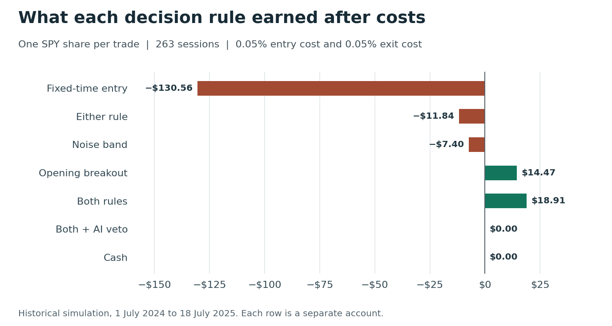

# Intraday evidence lab

Does an AI veto improve a day trade that two price-based rules already agree on? In this historical SPY experiment, both rules agreed 23 times. The rules earned **$18.91 after costs** on one share per trade. The trained model rejected all 23 and earned **$0**. The comparison is too uncertain to establish an edge.

The project traces two papers into executable rules, compares seven variants on the same market and clock, and records what each system knew before each trade. A paper runner can replay an archived session or watch arriving minute bars. An optional pair of local language-model reviewers can argue either side of a sealed decision.

## What traded

Each session starts at 09:30 New York time. At 10:00, the **breakout** voter checks whether SPY broke its first five-minute high after a positive opening candle and at least average opening volume. The **band** voter checks whether the move exceeds its normal opening move over the previous 14 valid sessions and whether price is above the opening volume-weighted average. Each rule knows the first half-hour. Neither has access to its fill.

The **AI veto** is a standardised logistic regression retrained at the start of each month on earlier resolved trades. It predicts the chance that a hypothetical fixed-time long ends positive after costs. It can accept an agreement only at a probability of at least 55%. A participating variant buys one simulated share at the 10:05 minute open and exits ten minutes before the official close. The shortened-session calendar is applied automatically.

| Variant | Trades | Gross P&L | Net P&L |
|---|---:|---:|---:|
| Stay in cash | 0 | $0.00 | $0.00 |
| Fixed-time entry every eligible day | 263 | $20.68 | -$130.56 |
| Opening breakout alone | 28 | $30.37 | $14.47 |
| Noise band alone | 53 | $22.93 | -$7.40 |
| Either rule | 58 | $21.25 | -$11.84 |
| Both rules agree | 23 | $32.05 | $18.91 |
| Both rules agree and AI accepts | 0 | $0.00 | $0.00 |

The common historical test runs from **1 July 2024 to 18 July 2025**. Each variant starts with $10,000 and pays 0.05% of traded value on each side. The fixed-time strategy's $20.68 gross became a $130.56 loss after 263 round trips. Agreement's $18.91 was 0.19% of its initial account. It falls to $5.76 at 0.10% per side. The primary difference, AI minus agreement, was **-$0.072 per eligible day**, with a paired 95% block-bootstrap interval from **-$0.472 to +$0.201**. All three registered comparison intervals span zero. [Cost scenarios](results/summary.csv) · [Paired comparisons](results/contrasts.csv)

## Try one decision

Python 3.12. From the repository root, create an environment and install the pinned requirements. The first command after installation works with the committed journal, without downloads, accounts or model keys.

~~~bash
python -m venv .venv
source .venv/bin/activate
python -m pip install -r requirements.txt
python -m intraday.review --date 2024-07-17
~~~

On Windows PowerShell, activate the environment with `.\.venv\Scripts\Activate.ps1`.

On 17 July 2024, opening volume was 1.68 times its recent mean and both rules voted yes. The model estimated 42.2%. Its veto avoided a $2.16 loss on that day. Across all 23 agreement days its veto also removed winning trades. The full decision, simulated fills and counterfactuals are in the [daily journal](results/journal.csv) and [trades](results/trades.csv).

~~~bash
python -m intraday --download --out runs/first
python -m intraday.paper --data data/primary.csv --replay 2024-07-17
python -m unittest discover -s tests -v
~~~

The first command downloads both pinned public archives, verifies their SHA-256 hashes, runs the historical experiment and checks the result with a second engine. Give each run a fresh output directory. The second command advances a single morning, entry and exit in sequence and writes idempotent events to SQLite. The example is also available as [a recorded replay](results/example_replay.json).

## Run a paper session

Start the watcher before 10:00 New York time. It will create a daily decision from arriving data, simulate participating variants and log their entry, exit or missed decision. You can use either your own atomically refreshed minute CSV or the read-only Alpaca market-data adapter. The Alpaca command reads `APCA_API_KEY_ID` and `APCA_API_SECRET_KEY` from your local environment. Use the data feed your account is entitled to. A process must be running during the decision window to create a prospective decision.

~~~bash
python -m intraday.paper --watch --data path/to/your_spy_minutes.csv
python -m intraday.paper --watch --alpaca iex
~~~

Choose one feed for a trial. Historical results use the two archived files. The forward adapter uses a distinct data source and has been exercised against recorded API-shaped fixtures. A live feed and a hosted watcher have not been activated for this project. [Data format, feed coverage and fill assumptions](research/data.md)

To invite two local reviewers, start Ollama with an installed model, then pass its tag. Both see identical anonymous features and work independently. Each returns a vote and a reason. Their output is commentary only. The recorded research run exercised the blind packet and a mocked model response. No language-model trading performance is claimed. [Ollama structured responses](https://ollama.com/blog/structured-outputs)

~~~bash
python -m intraday.review --date 2024-07-17 --model YOUR_LOCAL_MODEL
~~~

## Research trail

| Read this | What it shows |
|---|---|
| [Repository review](research/repositories.md) and [file manifest](research/source_manifest.csv) | 30 repositories, 48 pinned files and two official platform examples. Includes how trades are made, research attribution, shortcomings and design decisions. |
| [Paper register](research/papers.md) | The recent studies, what was implemented, the published details omitted by the adaptation, and why the other named ideas require different data. |
| [Protocol](protocol.json) and [decision log](research/trials.md) | Project authorship, frozen rules, missing-data decision, unsuccessful AI filter and an unrun follow-up hypothesis. |
| [Implementation](intraday/experiment.py) and [independent checks](intraday/checks.py) | Rolling signal calculation, monthly ML fit, cost scenarios, uncertainty estimates, a second ballot calculation and an external execution engine. |
| [Audit](results/audit.json) and [monthly fits](results/folds.csv) | 1,627 eligible ballots reconstructed, 425 simulated round trips reconciled across variants, and one conflicting band vote across 989 common archive dates. The variants can share trades. |

The two trading papers were written by the same three researchers, and both signals use the same underlying market data. This portfolio project's contribution is the test of their intersection and what it reveals when the AI sits out. The first implementation and research review were AI-assisted. The recorded return comes from a retrospective simulation using bar-open prices. There is no funded brokerage connection or live trading record.
