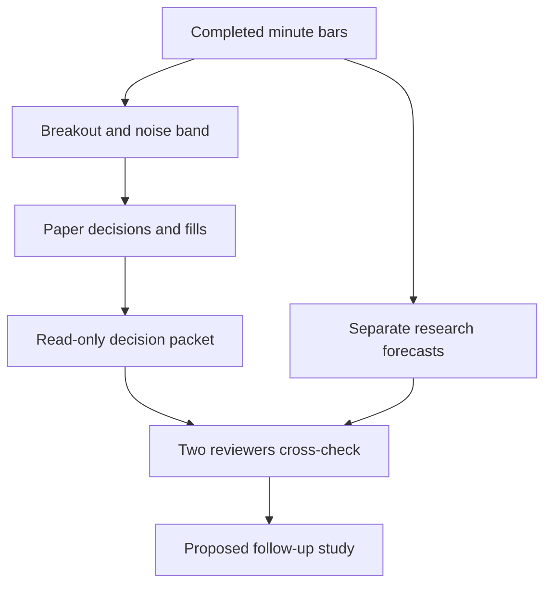

# Intraday evidence lab

An AI-assisted portfolio project that lets intraday rules make simulated decisions, then checks those decisions against the data. Version 2 removes the model veto and adds independent reviewers and research experiments that run alongside the rules.

## Replay a disagreement

[Download the strategy arena](https://github.com/raone101/intraday-evidence-lab/raw/refs/heads/main/arena/arena.html), open it in a browser, choose a session and reveal the outcome after reading the votes. On 11 July 2024 the breakout bot saw a price above the opening range on above-average volume. The VWAP bot saw a price 2.56 standard deviations above the morning average and went short. The weighted vote selected the long. Reveal the outcome to see how each original idea performed, how far it beat or trailed the selected position and what happened to its voting power. [Experiment notes and research lineage](arena/README.md) · [All session decisions](arena/sessions.csv)

## Interactive research desk

[Download the interactive desk](https://github.com/raone101/intraday-evidence-lab/raw/refs/heads/main/results/research-desk.html) and open the HTML file in a browser. It includes all 263 historical sessions. Select a strategy, choose how to handle negative signals and adjust the assumed cost per side. To serve the same interface locally, run `python -m intraday.desk` and open `http://127.0.0.1:8765`.

The new signal compares SPY’s 09:59 New York minute close with the arithmetic mean of the previous 60 exchange sessions’ 09:59 closes. Today is excluded. The percentage change is 100 × (current price / prior mean − 1). A missing reference price makes the signal unavailable. The main variant changes position at 10:05 only when two consecutive sessions agree on direction. It holds one virtual share long or short across nights until a confirmed change. Two consecutive zero readings move it to cash. A reversal covers the existing short and buys one long share, or sells the long and opens a short. Both legs incur costs.

| Historical comparison, July 2024 to July 2025 | Net USD at five basis points per side |
| --- | ---: |
| Confirmed mean, long or short across days | +17.42 |
| Confirmed mean, long or cash across days | +52.12 |
| Buy one share and hold throughout | +86.82 |
| Prior 60-session mean, long or short for the day only | −209.79 |

The multi-day long/short variant spent 195 sessions long and 68 short, changed position nine times including its first entry, and fell $95.82 from a previous marked portfolio peak. Each day is marked ten minutes before the exchange closes. The last historical position is liquidated at that mark. These are price-based simulations. The adjustment basis of the source archive is unverified. Short availability, borrow fees, cash interest and separate dividend payments are unmodelled. The two-session confirmation is an experimental assumption chosen before running this comparison on a previously used archive.

### Platform connections

- **OpenBB Workspace** can use the running local desk as a custom backend. Connect `http://127.0.0.1:8765` and add the **SPY historical sessions** and **SPY forward journal** table widgets. The latter reads dated files in your checkout. Pull updates to see newly published positions. [OpenBB data integration](https://docs.openbb.co/workspace/developers/data-integration)
- **Microsoft Qlib** can consume the signal through `python -m intraday.momentum --data data/primary.csv --out runs/sessions.csv --qlib runs/scores.pkl`. Load this locally generated file with `pandas.read_pickle`. Its index is New York local `datetime` and `instrument`, and its `score` is the signed percentage. Qlib users need matching US instrument and calendar data to run a separate backtest. The execution comparison here uses the lab’s simulator. [Qlib signal format](https://qlib.readthedocs.io/en/latest/component/strategy.html)
- **TradingAgents** is an optional independent market analyst. In a separate environment install the lab dependencies and the [reviewed TradingAgents version](https://github.com/TauricResearch/TradingAgents/tree/9fa1196fffbcfd9de5146d2dd2869df84ab99838) using its installation instructions. Start Ollama, pull a supported local model, then run `python -m intraday.agent_note --date 2024-07-17 --model YOUR_MODEL_TAG --out runs/agent-note.json` from this project. The note pairs the framework’s opinion with the lab’s signal for the same date. Its information sources may include later information, so it is a retrospective qualitative comparison. The experiment and the desk run without an AI API key.

## What is happening now

[Open the forward journal](forward/) to see the dated observations from GitHub Actions. The hosted runner needs two Alpaca paper-account secrets before it can read the SPY feed. Historical results below use the archived data.

Every eligible SPY session, the paper runner checks two rules using the first 30 minutes of completed market bars.

- **Opening breakout** checks for a green first five minutes, at least average opening volume and a break above the opening high.
- **Noise band** checks whether the first half-hour move is unusually large and above the opening volume-weighted average.
- **Paper variants** simulate each rule on its own, either rule, both rules agreeing, a fixed-time trade every eligible day, and cash. Each participating variant simulates one share at 10:05 New York time and exits ten minutes before the session closes. The stock exchange calendar handles early closes.

The optional AI reviewers first assess the same outcome-blind packet separately. Then each checks the other’s finding and proposes a correction or a future comparison. Their reports are read-only. Research forecasts are scored separately after the outcomes arrive. The paper runner works independently of both.



[17 July replay](results/v2/example_replay.json) shows the practical change. Both rules qualified, so the agreement variant recorded a simulated trade which lost $2.16 after costs. The earlier vetoed result is available in the [original version](https://github.com/raone101/intraday-evidence-lab/tree/5f4a21eeabe63e870c8c5a641c971c98bf3bddb1).

## Historical results

263 SPY sessions, 1 July 2024 to 18 July 2025. Each variant has $10,000 illustrative starting capital, a fixed one-share trade and an assumed 0.05% cost each side.

| Rule variant | Round trips | Net USD |
|---|---:|---:|
| Cash | 0 | $0.00 |
| Fixed-time entry | 263 | -$130.56 |
| Breakout | 28 | +$14.47 |
| Noise band | 53 | -$7.40 |
| Either rule | 58 | -$11.84 |
| Both rules agree | 23 | +$18.91 |

All 425 round trips across the six variants were reproduced by a separate fill engine. The rules share some information and their paired performance intervals span zero. The coverage and cost assumptions constrain what can be inferred about future returns. [Summary](results/v2/summary.csv) · [Journal](results/v2/journal.csv) · [Reconciliation](results/v2/audit.json)

### What the new models found

The attached papers inspired an opening **time-at-price profile**, a test of **pretraining on older data**, and separate results for different opening ranges. These are adaptations to the available SPY minute bars. Brier error measures the accuracy of a probability forecast. Lower is better.

| Test across all 263 sessions | Reduced error? |
|---|---|
| Opening-profile features added to the same 15-minute neural model | 0.1688 to 0.1671. An exploratory improvement of 0.0017. |
| Older-to-recent training versus the last 126 sessions alone | 0.1923 to 0.1632 for 15 minutes. Its comparison with a single full-history fit was inconclusive. |
| Forecasting the afternoon exit instead | All five matched comparisons were inconclusive. |
| Restricting either forecast to days both rules agreed | Only 23 matched observations. The trial requires 60 for directional evidence. |

The models were retrained before each test month. These are retrospective results from a reused date range and the interval checks are unadjusted for multiple comparisons. Forecast accuracy and simulated trading P&L are measured separately. [15-minute results](results/v2/shadow_15m_comparisons.csv) · [Afternoon results](results/v2/shadow_exit_comparisons.csv) · [Fill and cost stress](results/v2/fill_stress.csv)

## Run it locally

Use Python 3.12. Create an environment with `python -m venv .venv` and activate it with `.\.venv\Scripts\Activate.ps1` on Windows PowerShell or `source .venv/bin/activate` on macOS or Linux.

```bash
python -m pip install -r requirements.txt
python -m intraday.review --date 2024-07-17
python -m unittest discover -s tests -v
```

The first review reads the committed example journal and recomputes both flags locally. From a local archive, these commands reproduce the ledger and research:

```bash
python -m intraday --download --out runs/rules-v2
python -m intraday.paper --data data/primary.csv --replay 2024-07-17 --db runs/replay.sqlite
python -m intraday.shadow run --data data/primary.csv --out runs/shadow-15m
python -m intraday.review --date 2024-07-17 --db runs/replay.sqlite --forecasts runs/shadow-15m/predictions.csv
```

For two language model reviewers, add `--model YOUR_LOCAL_OLLAMA_MODEL --out runs/review-2024-07-17.json`. Replace the model tag with one installed locally in Ollama. Each response records its evidence and suggested experiment. Review errors stay in the review report. [Ollama structured responses](https://ollama.com/blog/structured-outputs)

## Paper watch and later tests

`python -m intraday.paper --watch --data path/to/spy-minute-bars.csv` or `python -m intraday.paper --watch --alpaca iex` watches current data during a running process and stores decisions separately from historical replay. The Alpaca reader uses locally configured `APCA_API_KEY_ID` and `APCA_API_SECRET_KEY` for market data. Start watching before 10:00 New York time. The local watcher records a SQLite ledger. The hosted runner records simulated decisions on GitHub. [Feed schema and fill assumptions](research/data.md)

For hands-off operation, add `APCA_API_KEY_ID` and `APCA_API_SECRET_KEY` from an Alpaca paper account to this repository’s **Settings → Secrets and variables → Actions**. Under **Actions → SPY paper journal → Run workflow**, select **check** to verify feed access. Scheduled runs record the morning decisions and settle them after the close. [Hosted schedule and journal fields](forward/)

A follow-up can be registered with `python -m intraday.shadow register --help`. It fixes the candidate, baseline, cohort, end date and implementation fingerprint before the evaluation period. Execute the first registered test once the CSV contains sessions after registration.

```bash
python -m intraday.shadow run --data path/to/growing-spy.csv --trial research/profile-follow-up.json --out runs/profile-follow-up
```

The report says whether the candidate lowered forecast error, raised it or remains inconclusive. It marks interim or small samples explicitly and keeps predictions out of the trading rule. A later test may supply `--transfer-data` and a distinct `--transfer-symbol` for the cross-instrument experiment. Register the source symbol with the trial before scoring.

## Research trail

| Record | Contents |
|---|---|
| [New paper register](research/papers-v2.md) | Adaptations, exact methods, controls and all supplied document dispositions |
| [Registered follow-up](research/profile-follow-up.json) | The first opening-profile hypothesis, with outcome dates after registration |
| [Repository review](research/repositories.md) and [source manifest](research/source_manifest.csv) | 48 pinned files across 30 projects and what shaped the first build |
| [Version 1 papers](research/papers.md) and [version 1 decision log](research/trials.md) | The origins of the two rules, earlier assumptions and the original AI veto result |

The original project brief supplied the two-rule comparison, cross-checking and journal workflow. An AI coding assistant built the first implementation and the reviewer-only update. All reported trials here are simulations.
